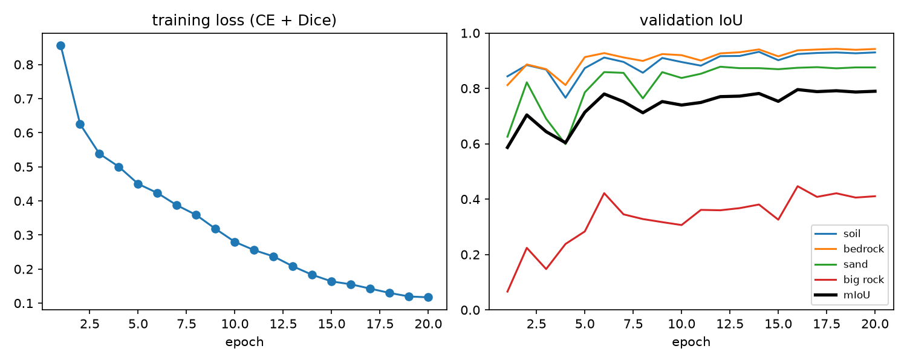
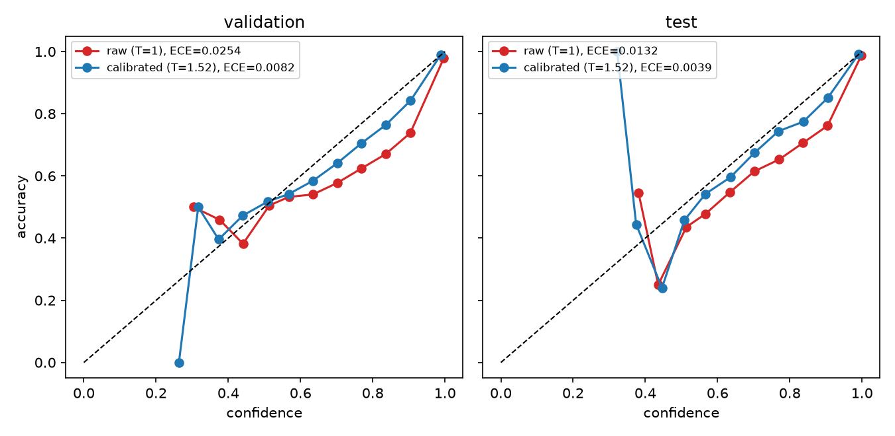

# Rover-Route

A Mars rover that **sees sand before it gets stuck**. A terrain model trained on real NASA
Curiosity images labels the ground ahead, and the rover plans around likely sand. We measure
how much safer that is than a rover that only checks slope.

## Why
Spirit got stuck in a sand trap in 2009 and never drove again. Slope alone can't tell soft sand
from solid ground; both can be flat. The rover has to look.

## How it works
1. **Real terrain data.** 149 top-down tiles built from AI4Mars (Curiosity NAVCAM images with
   human labels: soil, bedrock, sand, big rock). Each tile is 20 x 20 cells. `data/preds20.npz`
   holds a ResNet34 U-Net's calibrated class probabilities for every cell (test mIoU 0.80,
   temperature 1.52); `data/tiles.npz` holds the true labels.
2. **World.** Each seed stitches 3 x 3 tiles into a 60 x 60 grid (0.5 m cells, 30 m across) and
   adds a random slope field. The true terrain is hidden from the rover.
3. **Perception.** The rover sees 3 m around itself. It always senses slope; depending on the
   mode it also gets the model's prediction (Rover-Route) or the true class (oracle).
4. **Cost map.** `cost = 1 + slope + terrain risk + uncertainty`. Too steep, likely sand
   (P >= 0.5) and likely big rock are blocked.
5. **Planning.** 8-connected A*, replanning every 4 steps or as soon as the route ahead is blocked.
6. **Evaluation.** Every mode drives the same seeded worlds. Hazard entries are scored against
   the true terrain.

## The terrain model
Code in [`ml/`](ml/), measured outputs in [`results/ml/`](results/ml/).

- **Data.** [AI4Mars](https://huggingface.co/datasets/hassanjbara/AI4MARS): Curiosity NAVCAM
  images with per-pixel labels. Train on 6,000 crowd-labelled images, pick the checkpoint and fit
  calibration on a fixed 500-image validation split, test on `test_min3` (322 images whose labels
  at least 3 experts agreed on). Rover-body and beyond-30 m pixels are ignored. A SHA-256 check
  finds 0 test images in the training data.
- **Model.** U-Net with a ResNet34 encoder pretrained on ImageNet, 256 px input, 4 classes.
- **Training.** Class-weighted cross-entropy + Dice loss (big rock is under 1% of pixels), AdamW
  3e-4, cosine schedule, flip and brightness augmentation, mixed precision; 20 epochs, about
  23 min on one GPU, best validation mIoU at epoch 16. Exported as 49 MB fp16 weights.
- **Calibration.** One temperature T fitted on validation logits by minimising NLL.
  T = 1.52 means the raw model was overconfident.
- **Into the rover.** Each image's calibrated probabilities are warped onto a top-down
  20 x 20 cell patch (flat-ground homography) and averaged per cell: `data/preds20.npz`.

| Test set (322 images) | soil | bedrock | sand | big rock | **mIoU** |
| --- | --- | --- | --- | --- | --- |
| IoU | 0.98 | 0.93 | **0.96** | 0.33 | **0.80** |

Pixel accuracy is 0.98. Big-rock recall is 98%, but its IoU is low because some bedrock gets
called big rock and true big rock is only 0.07% of test pixels.

| Calibration | ECE val | ECE test | NLL test |
| --- | --- | --- | --- |
| Raw (T = 1) | 0.025 | 0.013 | 0.082 |
| Calibrated (T = 1.52) | **0.008** | **0.004** | **0.069** |

CPU inference is about 90 ms per image (batch 1, 4 threads), fast enough to run on board.




## Results
100 seeded worlds, every rover on the same worlds (`python -m scripts.run_eval`, full table in
[`results/results.md`](results/results.md)):

| Rover | Success [95% CI] | Reached goal | Hazard entries / mission | Route ratio |
| --- | --- | --- | --- | --- |
| Geometry only (slope) | 0.46 [0.36, 0.55] | 1.00 | 0.71 | 1.009 |
| **Rover-Route (model)** | **0.72** [0.63, 0.80] | 0.76 | **0.06** | 1.086 |
| Oracle (true terrain) | 1.00 | 1.00 | 0.00 | 1.080 |

- Rover-Route enters hazards **about 12x less often** than the slope-only rover, for routes
  about 8% longer than the safest possible route.
- Its main failure is being too careful. In 24 of 100 worlds, predicted sand closed every route
  and it stopped safely instead of reaching the goal.

### Do the model choices matter to the rover?
Same 100 worlds, model rover only ([`results/ablation.md`](results/ablation.md)):

| Config | Success | Reached goal | Hazard entries / mission |
| --- | --- | --- | --- |
| Calibrated, block P >= 0.5 (shipped) | 0.72 | 0.76 | 0.06 |
| Raw T = 1, block P >= 0.5 | 0.71 | 0.76 | 0.07 |
| Calibrated, block P >= 0.3 | 0.72 | 0.74 | **0.04** |
| Calibrated, block P >= 0.7 | 0.76 | 0.80 | 0.06 |
| Calibrated, no uncertainty cost | 0.71 | 0.76 | 0.09 |

Honest reading: these differences are small and inside the confidence intervals. Most of the
safety gain comes from the model being accurate on sand (IoU 0.96), not from calibration or
the threshold. Most cells are predicted with over 95% confidence, so T barely changes which
cells get blocked. Removing the uncertainty cost gives the most hazard entries. The P >= 0.7
row looks best, but it was picked on these same worlds, so the shipped setting stays at 0.5.

## Run it
```bash
python -m venv .venv && .venv/Scripts/activate      # macOS/Linux: source .venv/bin/activate
pip install -r requirements.txt
streamlit run app.py                 # mission view (demo seed 18)
python -m scripts.run_eval --n 100   # regenerate results/
python -m scripts.pick_demo          # seeds where the model visibly detours
python -m scripts.ablation --n 100  # model choices vs rover outcome
python -m pytest -q
```

### The model (optional; the app only needs `data/preds20.npz`)
```bash
pip install -r requirements-ml.txt   # torch, segmentation-models-pytorch, datasets, opencv
python -m ml.train                   # downloads AI4Mars, trains, writes ml/weights/unet_r34_fp16.pt
python -m ml.precompute              # val/test logits + data/preds20.npz
python -m ml.calibrate               # fits T, writes results/ml/calibration.json
python -m ml.precompute              # re-export the rover tiles with the fitted T
python -m ml.evaluate                # test mIoU, confusion matrix, CPU latency
```
Weights are not in git (49 MB). Train them, or point `RR_WEIGHTS` at a copy. Big intermediate
files go to `RR_ARTIFACTS` (default `artifacts/`), and the cached dataset to `RR_DATA`.
`ml.precompute` run with the shipped weights and T reproduces `data/preds20.npz` exactly.

## Layout
```
app.py                 Streamlit mission view
roverroute/            data, world, perception, costmap, planner, rover, metrics, card
ml/                    data, model, train, evaluate, calibrate, precompute
scripts/               run_eval.py, pick_demo.py, ablation.py
data/                  tile labels, model predictions (calibrated + raw), camera frames + overlays
results/               rover results, ablation; results/ml/ model metrics, logs, plots
tests/                 planner, metrics, rover, decision card
```

## Honesty notes
- The images come from Curiosity at Gale crater. The map is a synthetic grid stitched from
  unrelated images, so tile edges don't line up, and the slope field is random.
- The tiles come from a flat-ground projection without camera calibration.
- The tile library has almost no big rocks, so the hazards here are sand and steep slope.
- Model predictions are precomputed per cell by `ml/precompute.py`; the app does not run the
  network live.
- The model was trained on a GPU. The test metrics in `results/ml/` were re-run on CPU with the
  ported code and match the GPU run to 4 decimal places (mIoU 0.7998 vs 0.7999).
- Rover motion and sensing are simplified. This is a proof of the idea, not flight software.
